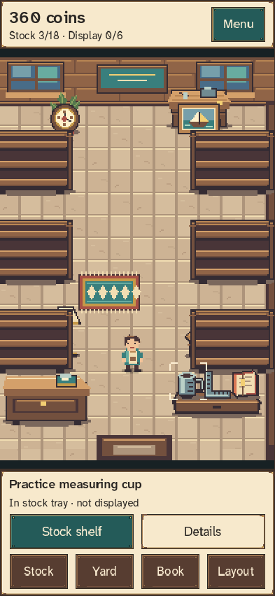
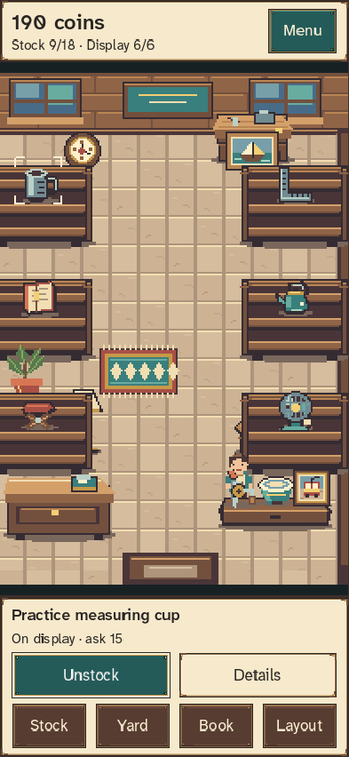

# Lantern Lot

An offline secondhand-shop game built in **Godot 4.7.2 Standard**, typed GDScript, and the Compatibility renderer. A warm harbor shop and storage yard now present the existing economic prototype as persistent, interactive pixel-art rooms. The [visual brief](docs/VISUAL_OVERHAUL.md) governs this presentation; [DESIGN.md](DESIGN.md) retains the larger future design.

| A quiet beginning | Six real displayed goods |
|---|---|
|  |  |

[Watch the 20-second runtime preview](docs/screenshots/lantern-lot-demo.mp4).

## Run

Import `project.godot` in Godot 4.7.2 and press **F5**. The development window is portrait, 450 × 800. The room occupies the main play area; its HUD and action dock remain in place. Tap a good to select it, then use the labeled action. Drag the room to pan, or tap empty floor to walk. Walking never delays a financial decision.

**Stock** opens the inventory drawer, **Yard** enters the auction, **Book** opens collection knowledge, and **Layout** edits free decorations and display positions. **Menu** holds Open shop, batch appraisal, sorting, stock racks, receipts, help and settings. Text sizes are 100%, 150% and 200%; motion and audio can be disabled. Tab/Shift-Tab move focus, Enter/Space activate, and Escape closes a sheet or cancels layout mode. Objects and fixtures has equivalent labeled world targets.

Start with 360 coins and three practice objects. Stock shelves, set asking prices, and open a six-visitor customer wave. Or visit the yard, inspect two of four targets, tighten your ceiling, and bid or leave. Winning deducts the bid and transfers all six objects in one transaction. Appraise all before listing. Sales show the 8% fee before confirmation. Dealer liquidation pays 50% reference with no fee. Sorting's accessible skip pays 40 without collection rewards.

Every acknowledged economic action saves locally under `user://lantern_lot_prototype`. Two checksummed snapshots and a previous snapshot permit fallback after corruption. No accounts, background income, network gameplay, or analytics. If writing fails, gameplay pauses with **Retry save**. If all snapshots are incompatible or corrupt, originals are retained and the app blocks automatic reset. For manual recovery, close the app and back up the entire save folder before replacing a snapshot; removing the folder starts fresh. User-facing export/import and reset confirmation are later work.

## Verify

```powershell
& 'D:\Godot\Godot_v4.7.2-stable_win64_console.exe' --headless --path . --script tests/run.gd
```

The tests cover integer valuation and cost allocation; legal turns and permanent withdrawal; 100 deterministic auction scenarios; resumed full shop loops; duplicate/stale commands; inventory reserve; fee/counteroffer rules; disk replay, corruption fallback, and denied saves. These are automated development checks, not the design's required human playtests or physical Android acceptance.

For a UI capture, run the game with `-- --ui-smoke`. The harness completes an isolated loop and writes the full evidence set to `build/visual-overhaul-evidence/<actual-window-size>/`, including sidecar geometry/state summaries. `--startup-smoke` also isolates saves for bounded headless startup. Run `tests/preview.tscn` for a playable scratch-save preview without touching the normal game. `build/` is excluded from Git.

For the complete desktop verification (Godot import, existing domain checks, presentation/controller/responsive checks, rendered captures, measured profile and optional movie):

```powershell
.\tools\verify.ps1 -PythonExecutable python -FullSizeMatrix -RecordMovie
```

Python requires Pillow for the asset gate. Use your bundled Python path if it is not on PATH. The verifier retains complete logs and exit statuses, rejects unexpected errors, and leaves the deliberate invalid-directory save failures visible. Engine editor-data writes may require an approved run on this managed Windows machine; keep Godot safe-save enabled. Captures must still be inspected directly.

## Prototype scope

Implemented: the exact six-item economic example, four truthful inspection targets, three seeded public-information rivals, protected ceilings, win/loss receipts, appraisal, six shelves, pricing, one counteroffer, six paused customer encounters, collection notebook, dealer sales, stock racks, recovery, and transactional local saves. Scenes present snapshots and submit commands; domain modules own the economy.

This prototype deliberately repeats **one authored household-clearance fixture**, giving each visit a fresh listing ID. It does not claim to implement the randomized three-listing board or the 40-item MVP. Rivals currently use category priors because this fixture's doorway reveals categories without verified identities. UI text/content identifiers are provisional; production translation keys and full schema manifests remain to be authored.

The overhaul adds original goods, dedicated inspect art, directional actors, six free decorations, movable displays, local audio, a separate visual save, integer physical world magnification, large-text sheets, safe-area handling and visible save recovery. Visual save recovery cannot repair or reset economic inventory. See [overhaul status and acceptance evidence](docs/VISUAL_OVERHAUL_STATUS.md) for tested boundaries.

Still outside this build: randomized catalog/board expansion, relationships and exhibition progression. Physical Android/iOS performance, actual notches and suspension, mobile screen readers, export/release readiness and human playtests remain unverified. Desktop rendering and simulated insets do not establish mobile readiness.

See [development status](docs/DEVELOPMENT.md) for milestones and verification notes. Engine/export upgrades require a deliberate migration. No store release is implied.
